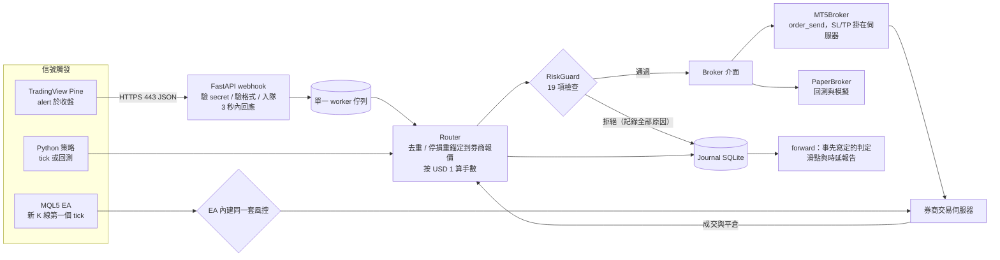

# 微型本金自動化 Scalping：系統架構與實戰指南

> 對象：帳戶約 USD 100、每筆風險約 USD 1 的自動化當沖。平台：MT5（MQL5 / Python）或 TradingView（Pine + Webhook）。
> 本文所有程式碼都在本 repo；數字都附來源與重現指令。**不是投資建議**；示範策略**不是**優勢。

## 0. 先講結論（請先讀這一節）

**這個 repo 給你的是「管線 + 風控 + 驗證流程」，不是一個會賺錢的策略。** 理由來自 fx-board 的研究：

- fx-board 用 7 個公開規則 × 8 個品種，在 1h／4h 上做前向步進回測（2021-07 起 5 年、樣本外 38,557 筆）：**56 格全部沒有通過**；去掉點差後平均約 −0.01R，接近零；扣掉成本後平均約 −0.07R。也就是說，**這類規則沒有優勢，扣成本後的期望值大約就等於「負的成本」**（fx-board `docs/APP.md` §8、`docs/RESEARCH-STATUS.md`）。
- 同一個事實套在 scalping 上：停損縮小，成本不變，**成本佔停損的比例 c 就放大**。沒有優勢的規則每筆平均虧 c R。

**實測：成本佔停損的比例（停損 = 1.5 × 中位真實波幅）**

| 品種 | 1 分鐘 | 5 分鐘 | 15 分鐘 | 1 小時 |
|---|---|---|---|---|
| EURUSD | **0.60R** | 0.30R | 0.19R | 0.08R |
| GBPUSD | 0.54R | 0.33R | 0.19R | 0.09R |
| USDJPY | 0.77R | 0.30R | 0.17R | 0.07R |
| AUDUSD | 0.87R | 0.46R | 0.25R | 0.11R |
| XAUUSD | 0.51R | 0.31R | 0.16R | 0.08R |
| XAGUSD | 0.72R | 0.40R | 0.20R | 0.09R |

來源：`python scripts/cost_by_timeframe.py <fx-board>/tests/fixtures/real/snapshot`。K 線是 biquote 2026-10-09 的真實快照（1m 為 10:41–15:40 UTC 的 300 根，歐美重疊時段，已是全日最好的流動性）；成本用 fx-board `js/config.js` 的估計（1.5 × 實測點差 + IBKR 手續費）。1 小時那欄（0.07–0.11R）和 fx-board 5 年研究的「淨 − 毛 ≈ 0.06R」吻合，所以這個成本估計是可信的量級。

**怎麼讀：** EURUSD 1 分鐘、報酬風險比 1.5，打和需要勝率 (1 + 0.60) / 2.5 = **64%**；隨機進場只有 40%。要靠 1 分鐘 scalping 賺錢，你的進場要比隨機好上一大截，而公開規則在 1h 上連 1% 都證明不了。

**因此本指南的實際建議：**
1. 先做 **5–15 分鐘**、停損 3–10 pips 的「慢 scalping」，把 c 壓在 **≤ 0.2**；1 分鐘只在你有實證的優勢時才做。
2. 只做成本最低的品種（EURUSD 等主要貨幣對）和流動性最高的時段（倫敦／紐約重疊）。
3. 系統的第一個工作是**活下來並量度真實成本**；第二個工作才是找優勢，而且要用事先寫定的規則判定（§5）。

---

## 1. 標的與經紀商選型

### 1.1 USD 1 風險在各種商品上可不可行

風險 = 手數 × 每手每點價值 × 停損距離。小帳戶的關鍵限制是**最小手數**：最小手數的風險已經超過 USD 1 的話，那筆交易就**不能做**（不是「做 0.01 手」）。本 repo 的 `qtrade/sizing.py` 和 EA 都**絕不把手數往上捨入**（原因碼 `MIN_LOT_RISK`）。

| 商品 | 最小單位 | 最小單位每 pip／每點 | USD 1 能配的停損 | 成本特性 |
|---|---|---|---|---|
| **外匯標準／ECN 帳戶** EURUSD 0.01 手（1,000 歐元） | 0.01 手 | USD 0.10 / pip | 停損 ≤ **10 pips** 時可用；3 pips → 0.03 手、5 pips → 0.02 手 | Raw 帳戶：點差 0.1–0.3 pip + 每手來回約 USD 6–7（≈0.6–0.7 pip）；標準帳戶：點差約 1–1.5 pip、無手續費 |
| **外匯美分帳戶** EURUSD 0.01 cent lot（10 歐元） | 0.01 cent lot | USD 0.001 / pip | 任意停損（顆粒度細 100 倍） | 點差通常較寬；帳戶以 **USC**（美分）計價；多為離岸監管 |
| **黃金** XAUUSD 0.01 手（1 oz） | 0.01 手 | USD 0.01 / 0.01 美元 | 停損 ≤ **USD 1.00** 才放得進；但 1m 中位波幅約 USD 1.95，1.5 × ATR ≈ USD 3 | **標準帳戶放不進 USD 1 風險**（隨機漫步回測：1,329 個訊號全部 `MIN_LOT_RISK`，0.01 手要冒約 USD 3–4.5）。只有美分帳戶可行 |
| **加密貨幣 USDⓈ-M 永續**（例：Binance） | 一般最小名義 5 USDT（個別合約可能更高，以 `exchangeInfo` 的 `MIN_NOTIONAL` 為準） | 依數量步長 | USD 1 ÷ 停損% = 名義；0.2% 停損 → 名義 USD 500 | **手續費按名義收**：c = 來回費率 ÷ 停損%。吃單 0.05% × 2 ÷ 0.2% = **0.5R**；全掛單 0.02% × 2 ÷ 0.2% = 0.2R（VIP0 常見費率，以交易所公告為準） |

> 美分帳戶小知識：MT5 回報的 `tick_value`、餘額都以**美分**計。把 USD 1 當成 1 USC 就是風險錯 100 倍。本 repo 自動把 `USC` 換算（`qtrade/router.py` 的 `USD_PER_UNIT`；EA 的 `AccountPerUSD()`），其他幣別必須手動設定，否則拒絕啟動。

### 1.2 推薦（按優先次序）

1. **EURUSD（或 GBPUSD／USDJPY）on Raw/ECN 帳戶，0.01 手起**：成本最低、流動性最好；USD 1 風險配 3–10 pips 停損，剛好是 5–15 分鐘級別。**主力。**
2. **美分帳戶（同一批主要貨幣對）**：用真錢做「實盤前向測試」最便宜的方法（真實成交、真實滑點，虧損以美分計）；也是黃金以 USD 1 風險交易的唯一途徑。代價：點差較寬、監管較弱，**只放你可以全損的錢**。
3. **加密貨幣微型永續**：24/7、最小名義低；但手續費佔比高（只用掛單才勉強可行）、波動跳空大。**香港居民注意**：證監會 2026-02 公佈的框架只容許持牌平台向**專業投資者**提供永續合約；境外平台的合法性與對手風險請自行評估。

### 1.3 經紀商檢查清單（揀之前逐項確認）

- 監管機構與客戶資金隔離；是否有負結餘保障。
- 帳戶類型：Raw spread + 每手手續費（scalping 首選）；是否有美分帳戶；最小手數 0.01、步長 0.01。
- **客戶協議有沒有禁止或限制 scalping／EA**：常見條款有「最短持倉時間」、「延遲套利」、「濫用交易」，違反可被取消盈利。
- 交易伺服器所在機房（LD4 倫敦、NY4 紐約、TY3 東京…）：決定 VPS 放哪裏。
- MT5 細節：品種後綴（`EURUSD.r`、`EURUSDc`）、`trade_stops_level`（最小停損距離）、成交模式（市價執行 vs 即時執行）、`filling_mode`。
- 實測：開一個模擬帳戶跑 `qtrade` 或 EA 一星期，看 journal 的點差中位數與滑點，**用你的數字取代本文的估計**。

### 1.4 MT5 vs TradingView：執行時延、滑點、API 限制

| | **MQL5 EA**（在終端內） | **MT5 Python API**（`MetaTrader5` 套件） | **TradingView Pine + Webhook** |
|---|---|---|---|
| 觸發 | 每個 tick（`OnTick`），事件驅動 | 你自己輪詢（沒有回呼） | 警報（本 repo 用收盤觸發）；送達通常是**秒級**，官方沒有 SLA |
| 訊號 → 下單時延 | 終端內微秒級 + 到交易伺服器的網路（VPS 同機房約 1–10 ms；家用網絡約 50–300 ms：經驗值，請以 journal 實測） | 同左 + IPC（毫秒級）+ 輪詢間隔 | TradingView 處理 + 送達（秒級）+ 你的伺服器 + 券商 |
| 滑點 | 最低 | 低 | 最高（秒級延遲期間價格已移動） |
| 價格來源 | **券商自己的報價** | 券商自己的報價 | **TradingView 的資料源 ≠ 券商**（點差、tick 都不同） |
| 回測 | Strategy Tester「Every tick based on real ticks」+ 執行延遲設定（真 tick 級，含券商點差） | 自備（本 repo `qtrade.backtest`，tick 級） | K 線級策略測試器，點差與成交簡化 |
| 限制 | 每個圖表單執行緒；MetaQuotes VPS 約 USD 10–15/月、禁用 DLL | **只限 Windows**、終端必須在運行；不能放 MetaQuotes VPS；一個終端一個帳戶 | 需付費方案與**雙重認證**；只接受 **80/443 埠**、IPv4；伺服器 **3 秒內**不回應即取消；不替你重送；警報數量受方案限制 |
| Scalping 適合度 | ✅ 最佳 | ✅ 可以（要 Windows VPS） | ⚠️ 只適合秒級延遲不重要的 ≥ 5 分鐘訊號 |

**結論：** 真正的 scalping 用 **MQL5 EA**（放 MetaQuotes VPS，最平、最近）。Python 適合研究、回測、監控，或你需要 Python 生態做訊號時（Windows VPS + MT5 Python）。TradingView 適合「你本來就在 TradingView 上看圖、訊號是 5–15 分鐘級」的情況，並且要接受秒級延遲與漏單風險（§5.3）。

---

## 2. 輕量化系統架構

### 2.1 模組數據流



**設計原則（都來自 fx-board／quant-dashboard 的教訓）：**

| 原則 | 做法 | 來源 |
|---|---|---|
| 回測與實盤跑**同一份程式碼** | `qtrade.backtest` 用的就是 live 的 `Router` + `RiskGuard` + `Journal`，只把 MT5 換成 `PaperBroker` | fx-board：分析核心是純函式，主執行緒／Worker／測試共用 |
| 訊號只傳**距離**，不傳價格 | Router 把停損／目標重錨定在**券商**的即時報價（買單從 bid 量起），USD 1 風險已含點差 | TradingView 資料源 ≠ 券商；fx-board 實測不同來源單根 K 線可差數個 pip |
| 每個訊號有**冪等鍵** | `id = 品種-K線開盤毫秒-方向`，三條路徑相同；journal 主鍵擋重複 | Webhook 重送／重複觸發 |
| 停損**掛在券商伺服器** | 下單即帶 SL/TP；程式死掉倉位仍受保護 | VPS 會重開、會斷線 |
| 狀態**持久化** | 日初權益、連虧、停機旗標寫 `state.json`（原子替換）；EA 用終端全域變數 | 重開程式就「忘記今日虧損」是日停損最常見的失效方式 |
| 監控**資料新鮮度**，不只監控「程序活着」 | `/health` 回報 worker 最後循環時間、守門狀態、券商連線；外部監控檢查時間戳 | quant-dashboard 2026-10-28 事故：生成時間新、數據日舊，十多日沒人發現 |

### 2.2 程式碼對照

| 模組 | 檔案 | 作用 |
|---|---|---|
| 信號 | `qtrade/strategies.py`、`pine/qscalp_alert.pine`、`mql5/Experts/QScalp.mq5` | 同一個示範規則的三種實作 |
| Webhook | `qtrade/webhook.py` | 驗證、入隊、單一 worker、`/health` |
| 路由 | `qtrade/router.py` | 去重 → 報價 → 重錨定 → 倉位 → 風控 → 下單 → journal；`sync()` 收平倉、時間停損 |
| 風控 | `qtrade/risk.py`、`qtrade/sizing.py`、`qtrade/costs.py` | §3 |
| 券商 | `qtrade/broker/mt5.py`、`qtrade/broker/paper.py` | MT5 實盤 / 模擬（回測） |
| 回測 | `qtrade/backtest.py`、`qtrade/data/{ticks,dukascopy,synth}.py` | tick 級回測、資料下載、隨機漫步對照 |
| 驗證 | `qtrade/forward.py`、`qtrade/journal.py` | 事先寫定的判定、執行品質報告 |

### 2.3 部署方案（由平到貴）

**方案 A（推薦）：MQL5 EA + MetaQuotes VPS**
- 在 MT5 終端「註冊虛擬主機」，系統自動選離券商伺服器最近的機房並顯示延遲；官方月費約 USD 10–15（年付較平）。
- 只跑 EA（不能跑 Python、不能用 DLL）；EA 的 `SendNotification` 會把「日停損觸發」「最大回撤停機」推送到 MT5 手機 App。
- 優點：最便宜、最低延遲、零運維。缺點：只能 MQL5。

**方案 B：Windows VPS（與券商伺服器同機房）+ MT5 終端 + Python**
- 適合需要 Python（`qtrade serve` 的 `kind = "mt5"`）或要接 TradingView。
- 用 Caddy 或 nginx 在 443 埠終止 TLS，反向代理到 `127.0.0.1:8000`（TradingView 只打 80/443）。防火牆只開 443；可以只放行 TradingView 公佈的 4 個發送 IP（會變，以官方頁面為準）。
- **校時**：Windows 時鐘常有秒級偏差，`STALE_SIGNAL` 判斷靠它。開 NTP（`w32tm /resync`）。
- 開機自動啟動 MT5 與 `qtrade serve`（工作排程器）；MT5 開啟「演算法交易」，否則全部訂單回 10027。

**方案 C：加密貨幣（Linux 小 VPS，放在交易所撮合引擎附近的區域，請以 ping 實測）**
- WebSocket 處理：
  - **心跳**：照交易所規定回 ping/pong；N 秒沒有訊息就主動重連。
  - **重連**：指數退避 + 隨機抖動（1、2、4、8… 秒，上限 30–60 秒），避免和其他人同時重連被限流。
  - **補缺口**：重連後先用 REST 拿快照／最近成交，再接回串流；訂單簿用序號檢查連續性，不連續就重拿快照（fx-board 的「斷線後只補缺口」同一思路）。
  - **報價過期即停**：最後一個 tick 超過 `max_quote_age_ms` 就拒絕進場（`STALE_QUOTE`）。
  - **成交以用戶資料流為主、REST 定期對帳為輔**；Binance 類的 listenKey 要定期續期。
  - **限流**：照交易所的權重限制做本地 token bucket；被 429 就退避，不要硬撞。
- 適配：新增一個實作 `qtrade/broker/base.py` 介面（`quote/spec/account/positions/place/close/closed`）的 broker 類別即可，風控與 journal 不用改。

---

## 3. 風險控制機制（小本金爆倉防護）

所有進場都要通過 `RiskGuard.check_entry`（Python）或 `TryEnter`（EA）。**每一項不通過的檢查都會記錄**（不是只記第一項），journal 會告訴你交易為甚麼被擋。

### 3.1 檢查一覽（預設值針對 USD 100 帳戶、USD 1 風險）

| 類別 | 原因碼 | 預設 | 說明 |
|---|---|---|---|
| **固定金額** | `MIN_LOT_RISK` | USD 1 | 手數 = floor(USD 1 ÷ 每手停損虧損)；每手虧損 = (停損距離 + 點差 + 滑點預留) × 每點價值 + 每手手續費。最小手數放不進就不做 |
| **日停損** | `DAILY_LOSS` | USD 4（4R） | **最壞情況**：(日初權益 − 現在權益) + 未平倉倉位的剩餘風險 + 這筆的風險 > 4 → 拒絕。所以觸及前就停，不會因同時開多筆而超標 |
| | `DAILY_HALT` | | 日虧損已達 4 → 當日停機，即使權益之後回升；交易日在**紐約 17:00** 換日（多數券商的伺服器午夜） |
| **爆倉防護** | `KILLED` | 從高峰回落 USD 20 | 黏性停機：之後幾日、權益回升都不會自動解除，要人手清除 `state.json` 的 `killed`（EA：刪除全域變數 `QS_<magic>_killed`） |
| | `KILL_SWITCH` | 檔案 `KILL` | 建立這個檔案即時停止所有進場（EA：`Common\Files\QScalp.KILL`） |
| **頻率限制** | `MIN_INTERVAL` | 60 秒 | 兩次進場最短間隔 |
| | `RATE_WINDOW` | 每小時 6 筆 | 滑動視窗 |
| | `MAX_TRADES_DAY` | 每日 20 筆 | |
| | `COOLDOWN` | 連虧 3 筆 → 停 60 分鐘 | 防止「報復式交易」與狀態失效時連續虧損 |
| | `MAX_POSITIONS` | 1 | 同時持倉數 |
| **點差避險** | `SPREAD_ABS` | EURUSD 12 點（1.2 pip） | 絕對上限（按品種） |
| | `SPREAD_TO_STOP` | 0.2 | 點差 ÷ 停損 > 0.2 就不做：直接把 §0 的 c 限住 |
| | `SPREAD_SPIKE` | 2 × 中位數 | 相對最近 300 個 tick 的點差中位數突然擴大（消息、流動性斷層） |
| | `STOPS_LEVEL` | 券商設定 | 停損／目標比券商最小距離還近 |
| **時段** | `OFF_SESSION` | 07:00–16:30 UTC | 只做流動性最好的時段 |
| | `ROLLOVER` | 紐約 16:55–18:05 | 換日前後點差爆開、收隔夜利息 |
| | `NEWS` | 高影響事件前 5 / 後 10 分鐘 | Python：fx-board 格式的日曆 CSV；EA：MT5 內建經濟日曆（只在實盤有效） |
| **資料新鮮度** | `STALE_QUOTE` / `STALE_SIGNAL` | 3 秒 / 5 秒 | 報價或訊號太舊就不做（TradingView 路徑特別重要） |

另外在路由層：
- **成交偏離**：價格在決策到送單之間移動超過 `max_slippage_points`（MT5 `deviation`）→ 拒絕成交。
- **時間停損**：持倉超過 `max_hold_s`（預設 30 分鐘）強制平倉。
- **停損不是保證價**：跳空時停損以觸發時的報價成交。測試 `test_stop_out_reaches_the_journal_and_the_guard` 示範跳空 1 pip 令虧損變成 −1.26R；這也是日停損用「最壞情況」計的原因。

### 3.2 USD 1 倉位速查（EURUSD，Raw 帳戶：點差 0.2 pip + 每手 USD 7）

| 停損（pips，從 bid 量起） | 手數 | 實際風險 | 成本 ÷ 風險 |
|---|---|---|---|
| 3 | 0.02 | USD 0.78 | 0.23 |
| 5 | 0.01 | USD 0.59 | 0.15 |
| 8 | 0.01 | USD 0.89 | 0.10 |
| 10 | — | 0.01 手要 USD 1.09 → **拒絕** | — |

風險 = (停損 + 0.2 pip 點差) × 每 pip 價值 + 手續費；成本 = 點差 + 手續費 = 0.9 pip。手續費也算在風險內，所以 10 pips 停損用 0.01 手會超出 USD 1；要接受就設 `size_overshoot = 0.1`。（`qtrade/sizing.py`；`test_costs_sizing.py` 有同樣的例子。）

### 3.3 實證：沒有優勢時，風控做了甚麼

`python -m qtrade.cli backtest --ticks synthetic:20 --symbol EURUSD --config config.example.toml --compare --any-session`
（20 日隨機漫步，346 萬個 tick，點差 0.2 pip + 每手 USD 7，USD 100 帳戶）：

```
signals 1331 {'placed': 139, 'rejected': 1192}
rejections by reason: {'KILLED': 755, 'DAILY_LOSS': 228, 'MAX_TRADES_DAY': 127, 'ROLLOVER': 72, 'MAX_POSITIONS': 40, 'COOLDOWN': 23, ...}
net        trades  139  win 44.6%  avg -0.174R  se 0.040  cost 0.241R  rejected  pnl -18.38  maxDD 20.34
zero-cost  trades  308  win 41.2%  avg +0.010R  se 0.056  cost 0.000R  unclear   pnl  +1.34  maxDD 16.37
```

- 零成本時平均 +0.01R（≈ 0，正確：隨機漫步沒有優勢）；扣成本後 −0.17R，量級就是每筆的成本 0.24R。**這正是 §0 的公式。**
- 日停損與連虧冷卻把每日虧損限住；累計虧到 USD 20 時 `KILLED` 停機，之後 755 個訊號全部被擋：**帳戶不會被一個沒有優勢的策略慢慢磨光。**（maxDD 20.34 > 20：停機時最後一筆仍在場，最壞超出一筆的風險。）

---

## 4. 核心程式碼骨架

### 4.1 安裝與快速試跑

```bash
python -m venv .venv && . .venv/bin/activate       # Windows: .venv\Scripts\activate
pip install -e ".[dev,server]"                      # Windows 實盤再加 [mt5]
python -m pytest -q                                 # 50 項測試

python -m qtrade.cli costs --cost 0.00009 --stops 0.0002,0.0003,0.0005,0.001 --unit 0.0001
python -m qtrade.cli backtest --ticks synthetic:10 --symbol EURUSD --compare --any-session
```

`costs` 的輸出（成本 0.9 pip）：

```
    stop cost/stop no-edge EV    p* rr=1  p* rr=1.5    p* rr=2
       2      0.45     -0.45R      72.5%      58.0%      48.3%
       3      0.30     -0.30R      65.0%      52.0%      43.3%
       5      0.18     -0.18R      59.0%      47.2%      39.3%
      10      0.09     -0.09R      54.5%      43.6%      36.3%
```

### 4.2 MT5 方案 A：MQL5 EA（`mql5/Experts/QScalp.mq5`）

1. 複製到 `MQL5\Experts\`，在 MetaEditor 編譯（**本 repo 的環境沒有 MetaEditor，EA 未經編譯器驗證；第一次編譯如有錯誤請照錯誤訊息修正**）。
2. 拖到 EURUSD M1 圖表，填 `InpCommissionPerLotRT`（你的券商每手來回手續費），開啟「演算法交易」。
3. 結構：`OnTick` → 點差取樣 → `UpdateDay`（換日／日停機／回撤停機）→ 時間停損 → 新 K 線時 `Signal` → `TryEnter`（全部檢查 → `CTrade` 帶 SL/TP 下單）；`OnTradeTransaction` 記錄平倉 R。
4. Journal：`MQL5\Files\QScalp_<品種>.csv`（`PLACED/REJECT/FAILED/CLOSE`，含點差、風險、R、執行微秒數）。
5. 換成你自己的訊號：只改 `Signal()`，其餘不動。

### 4.3 MT5 方案 B：Python 連接 MetaTrader5（`qtrade/broker/mt5.py`）

```toml
# config.toml
[broker]
kind = "mt5"
login = 12345678
server = "YourBroker-Server"
password_env = "MT5_PASSWORD"     # 密碼放環境變數
[broker.symbol_map]
EURUSD = "EURUSD.r"               # 券商的品種名
[broker.commission_per_lot_rt]
EURUSD = 7.0
```

重點（都寫在程式碼註解）：`initialize` 後檢查 `trade_allowed`；`symbol_info` 每次重讀（交叉盤的 `tick_value` 會隨匯率變）；`filling_mode` 自動選 FOK / IOC / RETURN；只在 requote / price changed 時重試一次，並保持風控批准的**距離**重錨定；**MT5 回傳的時間是伺服器時區**（常見 UTC+2/+3）冒充 UTC，程式自動估計偏移（或設 `server_utc_offset_h`），否則過期檢查全錯；平倉盈虧用 `history_deals_get(position=…)` 加總 profit + commission + swap + fee。

### 4.4 TradingView 方案：Pine 警報 JSON + FastAPI Webhook

Pine（`pine/qscalp_alert.pine`）在 K 線收盤送出：

```json
{"secret":"<>=16 字元>","id":"EURUSD-1792486800000-buy","symbol":"EURUSD","side":"buy",
 "sl_dist":0.00023,"tp_dist":0.00034,"fire_ms":1792486860123,"strategy":"ema_cross_atr","price":1.10012}
```

- `id` = 品種-K 線開盤毫秒-方向（與 `qtrade/strategies.py` 相同）→ 冪等鍵。
- `sl_dist`/`tp_dist` 是距離；`price` 只在 paper 模擬時用作報價。
- `fire_ms` = Pine 的 `timenow`，接收端用它判斷 `STALE_SIGNAL`。

接收端（`qtrade/webhook.py`）：

```bash
export QTRADE_SECRET='至少16個字元的隨機字串'
python -m qtrade.cli serve --config config.toml   # paper 模式可在任何作業系統試跑
```

- `POST /tv`：自行解析 body（TradingView 對非 JSON 訊息送 `text/plain`）→ pydantic 驗格式 → `hmac.compare_digest` 驗 secret → 入隊 → **立即回 200**（遠低於 3 秒上限）。錯誤回應不回顯 body（內含 secret）。
- **單一 worker 執行緒**擁有 Router 與券商連線：訂單串行，沒有兩個訊號同時穿過風控的競態；MT5 套件只在一個執行緒被呼叫。
- `GET /health`：worker 是否存活、最後循環時間、最後錯誤、佇列長度、風控狀態、journal 計數、券商連線。用另一台機器每分鐘查一次，`last_loop_ms` 超過 2 分鐘沒更新就推 Telegram。

在 TradingView：圖表加上指標 → 建立警報 → 條件選這個指標的「任何 alert() 函數呼叫」→ Webhook URL 填 `https://你的網域/tv`。

---

## 5. 實戰部署與常見陷阱

### 5.1 驗證流程（每一關不過就不進下一關）

| 關卡 | 做甚麼 | 通過條件 |
|---|---|---|
| **0 成本關** | `qtrade costs`，用你券商的真實點差 + 手續費 | 你打算用的停損下 c ≤ 0.2 |
| **1 噪音對照** | `qtrade backtest --ticks synthetic:20 --compare` | 零成本 ≈ 0R、淨 ≈ −c。**策略在隨機漫步上賺錢 = 回測有前視偏差**（fx-board 掃描器也做同樣的雜訊校準）；測試 `test_random_walk_loses_about_the_cost` 與 `test_strategy_has_no_look_ahead` 會在 CI 檢查 |
| **2 Tick 級回測** | ① MT5 Strategy Tester：「Every tick based on real ticks」（券商自己的 tick 與點差）+ 設定執行延遲；② Python：MT5 匯出的 tick（`copy_ticks_range`）或 Dukascopy（`python -m qtrade.data.dukascopy`，ECN 點差偏窄，加 `--min-spread-points` 到你券商的水平）；`--latency-ms` 設實測值 | **先寫下**：參數、測試期、保留最後 30% 不看、檢驗了幾個假設 m。成本 × 1.5、時延 × 3 仍為正；樣本外下界 > 0 |
| **3 模擬盤前向**（2–4 週） | 同一設定跑模擬帳戶；TradingView 路徑對帳「TV 警報記錄 vs journal」 | 管線健康：漏單率、時延 p95、重開機後狀態正確、換日正確、KILL 檔有效。**不判定盈利**：模擬盤成交通常比實盤樂觀 |
| **4 實盤微型前向** | 美分帳戶或 0.01 手，真錢 | **事先寫定**：前 200 筆判定一次（`qtrade forward`）：日分群標準誤、Šidák 校正、下界 > 0 且平均 ≥ 0.05R 才算「確認」；從 30 筆起 95% 上限 < 0.05R 即「否決」；同時比較實盤滑點／時延與回測假設 |
| **5 放大** | 確認後才逐步加風險 | 每筆仍 ≤ 帳戶 1–2%；放大後重跑關卡 4 的執行品質報告 |

**為甚麼只判定一次：** fx-board 實測，每週用固定門檻檢查一次帳本，「完全沒有優勢卻在某一次被確認」的機率約 10%（名義 1%）；改成只在前 100 筆判定一次後約 1.4%（`docs/REVISION-2026-10-12-forward-rule.md`）。Scalping 交易多，本 repo 用 200 筆。也要誠實：報酬風險比 1.5 時每筆 R 的標準差約 1.2R，200 筆只能確認約 +0.2R 以上的優勢；中小優勢會是「不明」，這是固有代價，不是缺陷。

**多重檢驗：** 你每試一組參數、一個品種、一個時框，m 就加 1。fx-board 同時檢驗 56 格時，單格門檻 z = 2.5 會令「完全沒有優勢也至少出現一格已驗證」的機率達約 29%；用 Šidák 校正後 z ≈ 3.57。`qtrade forward --m <你試過的組合數>`。

### 5.2 零售高頻／Scalping 最常失敗的 3 個陷阱

**陷阱 1：手續費與點差吃掉利潤（最常見、最致命）**
- 症狀：回測（尤其 K 線級、零成本或固定小點差）漂亮，實盤慢慢虧。
- 數字：§0 的表；EURUSD 1 分鐘 c ≈ 0.6R、要 64% 勝率才打和。加密貨幣吃單手續費 0.2% 停損下 ≈ 0.5R。
- 解決：
  - 用 `qtrade costs` 先算 c，**c > 0.2 的設定不要開始**；`SPREAD_TO_STOP` 把它寫進風控。
  - Raw/ECN 帳戶；只做主要貨幣對與倫敦／紐約時段；拉長到 5–15 分鐘、加大停損（同樣 USD 1 風險，手數變小，c 變小）。
  - 加密貨幣只用掛單（maker）。
  - 回測永遠同時跑零成本與真實成本（`--compare`），看清楚「優勢」是不是比成本大。

**陷阱 2：點差擴大與滑點（換日、消息、流動性斷層、週末跳空）**
- 症狀：平時點差 0.2 pip，換日時 2–5 pip；消息公佈時停損滑幾個 pip；週一開市跳空越過停損。
- 解決：
  - `SPREAD_ABS` + `SPREAD_SPIKE`（相對中位數）+ `ROLLOVER` + `NEWS` + `OFF_SESSION` 五重過濾。
  - SL/TP 掛在伺服器；**接受停損不是保證價**，所以日停損用最壞情況計、`max_slippage_points` 拒絕偏離太遠的成交、`slippage_allowance_points` 把滑點預留算進手數。
  - 時間停損 + 週五收市前不留倉（把 `sessions_utc` 週五提早結束，或在策略層處理）。
  - 回測加點差下限（`--min-spread-points`）與時延（`--latency-ms`）；實盤看 `qtrade forward` 的 `slippage_median`、`latency_p95_ms`，比回測假設差就回到關卡 2。

**陷阱 3：Webhook 漏單、重複、延遲（TradingView 路徑）**
- 症狀：TradingView 有警報、帳戶沒單；同一訊號下兩張單；訊號遲幾秒到，入場價差很遠。
- 解決：
  - **冪等**：`id` 當主鍵，重複的永遠只執行一次（`test_valid_alert_is_queued_and_placed_once`）。
  - **快速回應**：只驗證、入隊、回 200；下單在 worker 做（3 秒限制）。
  - **過期丟棄**：`STALE_SIGNAL`（`fire_ms` vs 本機時鐘；VPS 要校時）。
  - **對帳**：每日比對 TradingView 警報記錄與 journal 的 `received` 數量；差額就是漏單率。
  - **監控**：外部每分鐘查 `/health`；警報在腳本出錯或到期時會停用，要定期檢查。
  - **品種名**：TradingView 的 `EURUSD` 未必是券商的 `EURUSD.r`／`EURUSDc` → `[broker.symbol_map]`。
  - **根本解**：真 scalping 不要走這條路，把訊號搬進 EA。

### 5.3 其他常見陷阱（簡表）

| 陷阱 | 解決 |
|---|---|
| 重開程式後日虧損歸零 | `state.json` 原子寫入；EA 用全域變數 + `GlobalVariablesFlush()`；測試 `test_halt_survives_a_restart` |
| 最小手數被捨入**向上** | `MIN_LOT_RISK`：放不進就不做 |
| 美分帳戶把 USC 當 USD | 自動換算；未知幣別拒絕啟動 |
| 時區與夏令時間 | Python 用 UTC + `America/New_York` 換日；EA 用伺服器時間（多數券商午夜 = 紐約 17:00，不是的話調整輸入） |
| MT5 時間戳是伺服器時區 | `MT5Broker._utc()` 自動估計偏移，或手動設定 |
| 參數優化過度、多重檢驗 | 參數事先固定；Šidák；保留樣本；fx-board 56 格 0 通過的經驗 |
| 模擬盤 ≠ 實盤 | 模擬只驗證管線；盈利判定只用實盤微型前向 |
| 券商條款禁止 scalping | 開戶前讀客戶協議（最短持倉時間、延遲套利） |
| Windows 上 `zoneinfo` 沒有時區資料 | `pip install tzdata`（`pyproject.toml` 已列為 Windows 依賴） |

---

## 參考來源

- TradingView：[About webhooks](https://www.tradingview.com/support/solutions/43000529348-webhooks)（80/443 埠、IPv4、3 秒逾時、雙重認證、發送 IP）
- MetaQuotes：[MetaTrader VPS 方案與價格](https://www.mql5.com/en/vps/forex-plans)
- Binance：[USDⓈ-M 永續合約規格](https://www.binance.com/en/support/articles/360033161972)（最小名義價值，以 API 為準）
- 香港證監會永續合約框架（2026-02）：[The Block](https://www.theblock.co/post/389377/hong-kong-expands-crypto-rules)、[Cointelegraph](https://cointelegraph.com/news/hong-kong-sfc-crypto-margin-perps-framework)
- fx-board：`docs/APP.md`（成本、資料品質、5 年掃描）、`docs/RESEARCH-STATUS.md`、`docs/REVISION-2026-10-12-forward-rule.md`、`js/config.js`（成本模型）
- quant-dashboard：`docs/INCIDENT-2026-10-28-STALE-DATA.md`（監控資料新鮮度）
